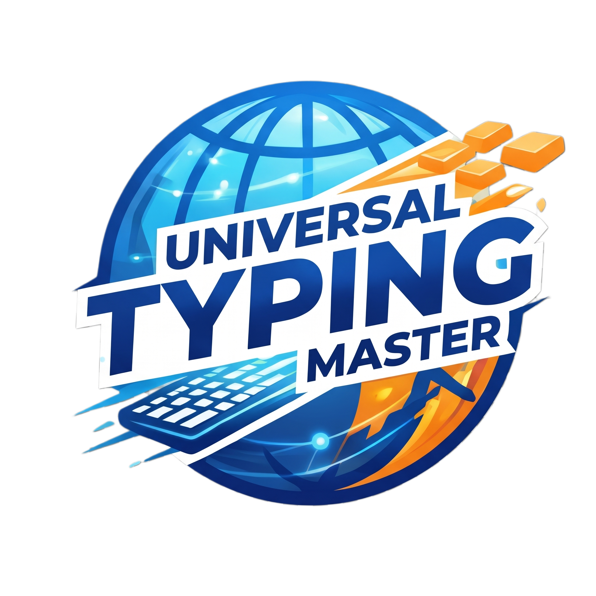

<div align="center">



# UNIVERSAL TYPING MASTER

### SHREE SWAMI SAMARTH COMPUTER EDUCATION INSTITUTE

**DISTRICT : KOLHAPUR, MAHARASHTRA**


<h3>⚡ A Complete Maharashtra GCC-TBC Typing Practice & Examination Platform ⚡</h3>


<br><br>


</div>

---

## 🔥 About The Project

**Universal Typing Master (UTM)** is a comprehensive web-based typing practice and examination platform tailored for Maharashtra GCC-TBC (30, 40, 50 WPM) students and computer institutes.

It provides a realistic typing examination environment with automated evaluation, student performance tracking, business letter practice, spreadsheet typing, email typing and a complete Admin & Student Dashboard.

## 🚀 Key Features

| Feature | Description |
|---|---|
| 👨‍🎓 Student Portal | Secure Student Registration and Login |
| ⌨️ Typing Practice | Multiple typing practice and examination modules |
| 📄 Word Upload | Upload and practice custom DOCX files |
| 📊 Statement | Excel-style spreadsheet typing interface |
| 📧 E-Mail | Realistic email typing practice |
| ✉️ Business Letter | GCC-TBC style business letter practice |
| 📚 Study Material | PDF learning materials and Objective MCQs |
| 🧮 Smart Evaluation | Full mistakes, Half mistakes, Omitted and Untyped words |
| 📈 Performance Graph | Student accuracy, WPM and test history |
| 🛠️ Admin Panel | Manage students, passages, letters, PDFs and questions |
| 🔒 Security | Password hashing, CSRF protection and secure uploads |

## ⌨️ Available Typing Modules

1. **📄 Upload Word File (.docx)** – Upload custom Word documents and practice with configurable settings.
2. **⌨️ UTM Practice** – Practice passages categorized by Easy, Medium and Hard difficulty.
3. **⏱️ State Pre-Exam** – GCC-TBC examination simulation with countdown and marking system.
4. **✉️ Business Letter** – Professional letter typing with ruler, indentation and alignment tools.
5. **📊 Statement (Spreadsheet)** – Excel-style grid, formatting tools and spreadsheet typing.
6. **📧 E-Mail Typing** – Practice formal email drafting with To, Cc, Bcc, Subject and attachments.
7. **📚 Study Material & Objective MCQ** – Access PDF study materials and practice objective questions.

## 🌐 Supported Languages

<div align="center">


<br><br>


</div>

## 🛠️ Technology Stack

| Layer | Technologies |
|---|---|
| Backend | PHP 8+ |
| Database | MySQL / MariaDB |
| Frontend | HTML5, CSS3, JavaScript |
| Libraries | PDF.js, HTML5 Canvas |
| Server | Apache / XAMPP |
| File Processing | DOCX, XLSX, PDF |

## 📂 Project Structure

```text
Universal_Typing_master/
│
├── index.php
├── admin.php
├── profile.php
├── utm_common.php
├── install.php
├── style.css
├── logo.png
│
└── uploads/
    ├── passages/
    ├── letters/
    ├── materials/
    └── documents/
```

## 🎯 Project Objective

The main objective of Universal Typing Master is to provide students with a professional platform to improve their typing speed, accuracy and examination performance.

It aims to simplify GCC-TBC preparation through realistic examination practice and centralized institute management.

---

## 🏫 Developed By

<div align="center">


# SHREE SWAMI SAMARTH

### COMPUTER EDUCATION INSTITUTE

**DISTRICT : KOLHAPUR, MAHARASHTRA**

*Learn • Practice • Improve • Succeed*

<br>

### ⚡ UNIVERSAL TYPING MASTER ⚡

**Practice Smart | Type Fast | Achieve More**

</div>
